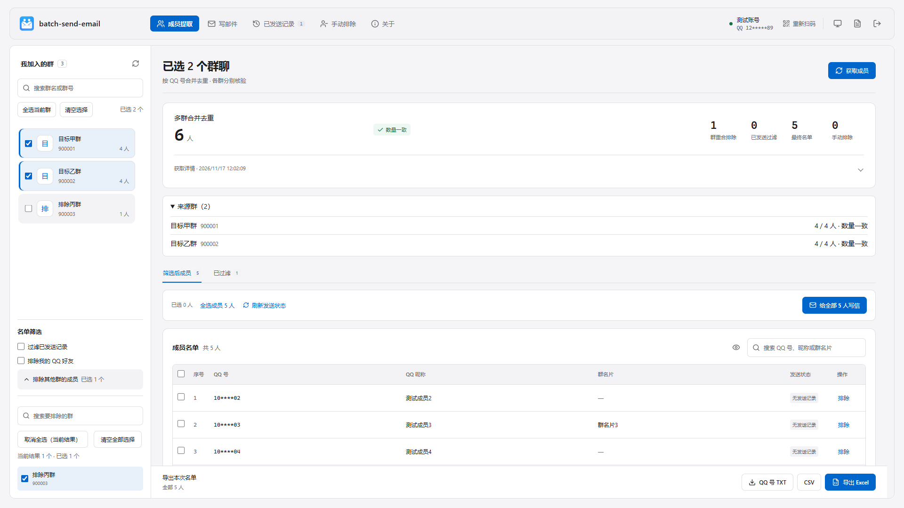
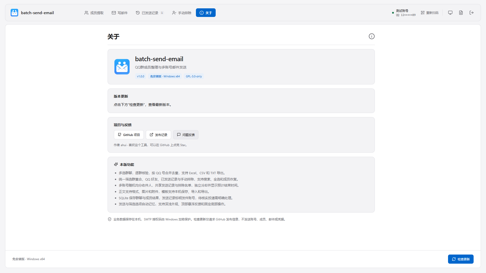

<div align="center">


# batch-send-email

Windows 本地邮件工具。支持多账号平均分配发送、邮件模板与名单排除，也可读取已加入 QQ 群的成员，合并去重后导出或写信。基于 Tauri 2、React、TypeScript 和 Rust。

中转站推荐：https://www.digitalcats.cc/register?aff=TBHUBP7TTL35

此中转站很润，不降智，稳定、纯绿色、低延迟、满血、满智商、平均缓存96以上、不烧心！

[](https://github.com/ahuiyuchuan/batch-send-email/releases)
[](https://github.com/ahuiyuchuan/batch-send-email/releases/latest)
[](https://tauri.app/)
[](https://github.com/ahuiyuchuan/batch-send-email/releases)
[](LICENSE)

欢迎提交Issues以支持改进本项目！

**[下载安装](#下载安装) · [界面预览](#界面预览) · [快速开始](#快速开始) · [功能特性](#功能特性) · [常见问题](#常见问题) · [使用手册](docs/使用说明.md) · [更新日志](CHANGELOG.md)**

</div>

> **v1.0.1：修复文本链接：支持插入、编辑、移除及模板保存，纯文本邮件也保留目标地址。** [查看发布说明](docs/release-notes/v1.0.1-zh.md) · [下载 Windows x64 EXE](https://github.com/ahuiyuchuan/batch-send-email/releases/download/v1.0.1/Batch-Send-Email-v1.0.1-Windows-x64.exe)

## 下载安装

当前正式版为 **v1.0.1**：[发布记录](https://github.com/ahuiyuchuan/batch-send-email/releases/tag/v1.0.1) · **[下载 Windows x64 EXE](https://github.com/ahuiyuchuan/batch-send-email/releases/download/v1.0.1/Batch-Send-Email-v1.0.1-Windows-x64.exe)**。

下载后直接运行，无需安装 Node.js、Rust 或独立浏览器。系统需 Windows 10 / 11 x64 和 [Microsoft Edge WebView2 Runtime](https://developer.microsoft.com/microsoft-edge/webview2/)。Release 只提供单个 EXE；SHA-256 列在发布正文中，GitHub 自动生成的 Source code 归档是源码。

升级前完全退出旧版并备份完整应用数据目录，再启动新版。项目改名仍沿用 `%LOCALAPPDATA%/com.ahui.qq-group-exporter/`，保留既有 SQLite、模板、发送记录、排除名单和 SMTP 密文，不自动搬迁或清空。QQ 登录仅保留在当前进程中，重启需重新扫码。

## 界面预览

以下图片来自 1920×1080 的隔离界面回归，群聊、账号和成员均为虚构数据，不代表真实 QQ 获取或 SMTP 投递结果。

<details open>
<summary><strong>成员提取：多群选择、统一筛选与合并名单</strong></summary>



</details>

<details>
<summary><strong>关于：版本、项目链接与更新检查</strong></summary>



</details>

## 快速开始

### 直接给邮箱写信

1. 打开“写邮件”，选择“快捷发送”，粘贴完整邮箱，推荐每行一个。
2. 在“发件设置”添加 SMTP 账号，填写服务器、端口、TLS 方式和邮箱授权码，保存后勾选参与发送的账号。
3. 填写主题、正文，或应用邮件模板；按需插入链接、图片和添加附件。
4. 点击“发送”，核对实际人数、各账号分配、间隔和预计结束时间，再“确认发送”。

无需先登录 QQ 或选择群。默认跳过已发送、失败后停止、密送每封20人、同账号间隔900秒、切换账号间隔60秒。默认值是本工具配置，不代表邮箱服务商允许的发送频率。

### 从 QQ 群取得名单

1. 点击右上角“扫码登录”，使用已加入目标群的 QQ 账号扫码并确认。
2. 勾选群名前复选框，可跨搜索多选、全选当前搜索结果或清空；点击群名可快速查看单群。
3. 按需设置排除群、QQ 好友及已发送过滤，点击“获取成员”。
4. 查看逐群核验与合并去重结果，导出 Excel / CSV / TXT，或勾选部分成员进入写信页。

所有目标群必须属于同一登录账号。任一群读取失败或取消均保留上次完整结果，不发布半套名单；多群并集按 QQ 号去重，各群参考人数不会直接相加。

## 功能特性

| 模块       | 当前功能                                                                                                      |
| ---------- | ------------------------------------------------------------------------------------------------------------- |
| 多群与名单 | 最多200个目标群、搜索范围全选、逐群核验、成员并集合并、来源追溯及独立组合缓存。                               |
| 名单筛选   | 排除群重合、可选 QQ 好友、已发送记录和全局手动排除；保留首次过滤原因，可明确恢复允许的过滤成员。              |
| 导出       | Excel 保留文本类型、获取说明及已过滤明细；CSV 为 UTF-8 BOM，TXT 为逐行 QQ 号。搜索不缩小导出范围。            |
| 多账号发送 | 最多20个 SMTP 账号，实际收件人数随机均分，账号之间最多相差1人；确认后固定计划，不重新分配。                   |
| 发送调度   | 逐人或密送分批、同账号冷却池、账号切换等待、倒计时、单次跳过等待、停止及预计完成日期时间。                    |
| 历史与排除 | 所有账号共用已发送和手动排除；记录保留原发件账号，结果不明确的投递须先核实，避免再次发送。                    |
| 邮件编辑   | 基础格式正文、文本链接、粘贴截图、CID 内嵌图片、附件与隔离预览；成员切换不会自动改写原邮件范围或草稿。                  |
| 模板       | 本机保存正文和资源、预览应用、重命名／复制／删除，支持带预览及冲突处理的 JSON 导入导出。                      |
| 本机保存   | SQLite 保存群目录、名单和业务记录，SMTP 授权码独立加密；发送选项与名单筛选记住上次合法选择。                  |
| 关于与更新 | 软件信息、更新、项目链接与功能卡片；启动与每小时静默检查正式 Release，支持底部手动重试和前往下载。 |
| 外观与操作 | 跟随系统／浅色／深色，顶部悬浮反馈、固定弹窗底部操作、键盘选择和搜索清除。                                    |

### 发送分配与冷却

收件人先去重并应用共享排除／历史，再随机均分。5个账号对应8人时为 `2、2、2、1、1`，对应10人时为 `2、2、2、2、2`，具体账号归属随机；分到0人的账号不发送。

每轮各有任务账号最多发送一批，优先处理已就绪账号。同一账号从上批结束计算冷却，其他账号不继承它的900秒，但仍需满足账号切换间隔。停止后重新发信仍核对原账号冷却；“跳过本次等待”只放行当前待发一批，不清空后续冷却。末批结束不追加等待。

服务器明确接受后才登记成功；结果不明确时进入“待核实”。不自动重发、拆分失败批次或把不确定结果当成功。SMTP 接受不等于收件箱送达，详细规则见[使用手册](docs/使用说明.md)。

### 数据与隐私

- SQLite：`%LOCALAPPDATA%/com.ahui.qq-group-exporter/data.sqlite3`。群目录、单群／组合最新结果按来源和 QQ 账号隔离，另外保留最近20次历史快照。
- QQ 会话只保留在当前进程，关闭后重新扫码。SMTP 授权码通过 Windows 本机保护机制加密并绑定账号身份，不进入 SQLite，也不能直接移植到其他 Windows 用户或电脑。
- 日志保留任务阶段、计数和脱敏错误，不记录主题、正文、完整收件邮箱、授权码、Cookie 或二维码。查看日志不会自动上传。
- 检查更新仅请求本项目 GitHub 公开发布信息，不发送群成员、邮箱名单、邮件内容或凭据；不自动下载或覆盖程序，发现新版后由你前往 Release 下载。

备份前退出程序并复制完整数据目录。数据库包含成员与邮箱等业务数据，请勿提交到仓库或公开反馈中。

## 常见问题

**为什么重启后需要扫码？** QQ 登录不落盘；已保存的名单、模板、发件配置和历史继续保留，读取新群数据需重新扫码。

**群人数一致就能保证完整吗？** 不能。它只表示当前已知参考条件满足；群成员变动、权限和接口行为仍可能影响结果，部分或待核验状态会随名单与导出保留。

**如何避免邮件进入垃圾箱？** 没有固定标题、正文或随机内容能保证进入收件箱。使用真实明确且符合收件人预期的内容、合理拒收方式与正确认证，遵守服务商额度；均分不代表可以绕过风控。

**名单超过10000人怎么办？** 完整名单仍可查看、保存和导出；单次写信上限10000人，请先勾选部分成员。模板、资源和其他边界见[完整手册](docs/使用说明.md)。

**检查更新失败意味着已是最新版吗？** 不意味着。网络、限流和无效发布信息会显示失败，可手动重试；仓库尚无正式版本时单独说明。更新检查不影响正在进行的获取或发送任务。

## 开发与贡献

技术结构为 Tauri 2 + Rust、React + TypeScript + Vite，数据使用 SQLite，界面由系统 WebView2 承载。源码依赖版本由 `Cargo.lock` 与 `package-lock.json` 固定。

```powershell
npm ci
npm run tauri -- dev

# 统一格式、静态检查、隔离回归与Windows x64构建。
$env:UI_CHECK_ONLY = 'detail-polish'
pwsh -NoProfile -File scripts/build.ps1 -OutputDirectory dist/v1.0.1
```

工具链、目录职责、数据边界和发布规范见 [CONTRIBUTING](CONTRIBUTING.md) 与 [开发说明](docs/DEVELOPMENT.md)。本版实际执行及未覆盖项目见 [VALIDATION](VALIDATION.md)，不要将隔离回归当成真实 QQ／SMTP 联调。

反馈问题请通过 [GitHub Issues](https://github.com/ahuiyuchuan/batch-send-email/issues)，提供版本、复现步骤和脱敏日志；不要上传真实数据库、地址名单或授权码。

## 开源协议

Copyright © 2026 ahui。项目采用 **GNU General Public License v3.0 only（GPL-3.0-only）**，完整条款见 [LICENSE](LICENSE)。第三方依赖保留各自许可证，说明见 [THIRD_PARTY_NOTICES](THIRD_PARTY_NOTICES.md)，运行依赖许可全文见 [合订本](docs/licenses/THIRD_PARTY_LICENSES.txt)。项目协议、第三方说明及许可合订本作为 `licenses/` 文本资源嵌入 EXE；许可原文与对应源码保留在仓库及同版本 Tag 中。
